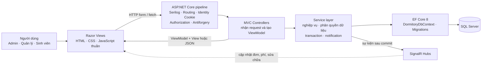
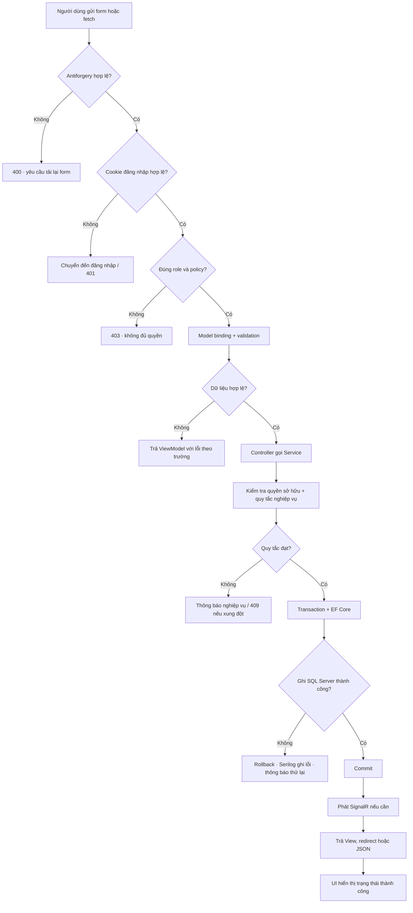
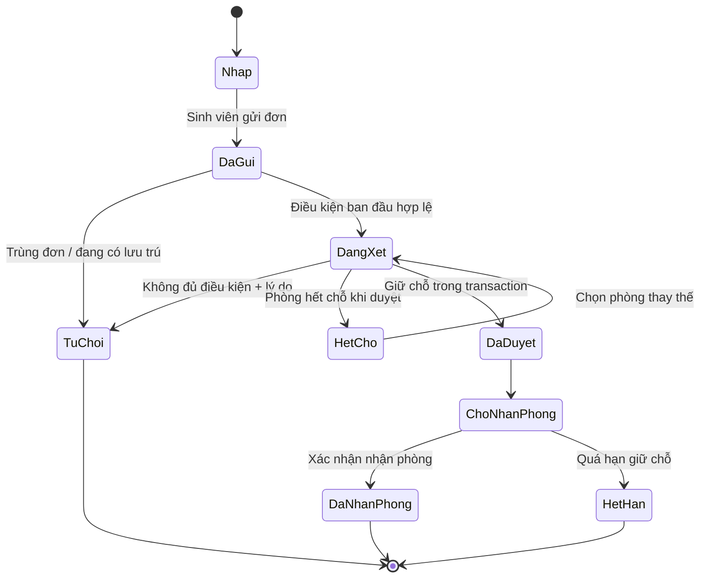
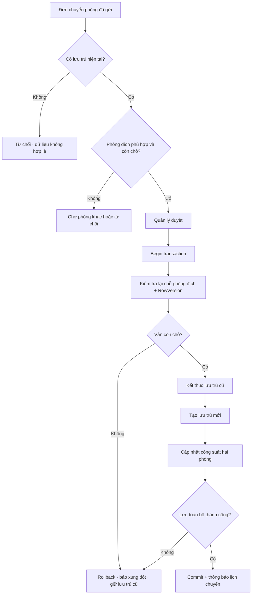
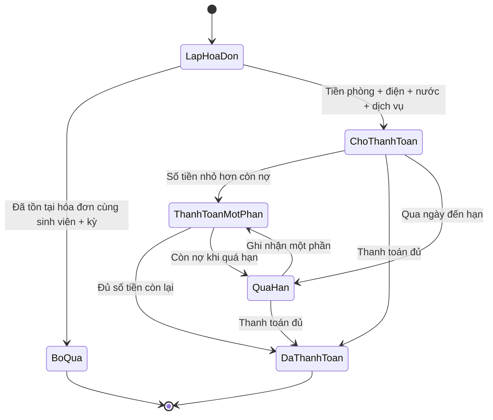
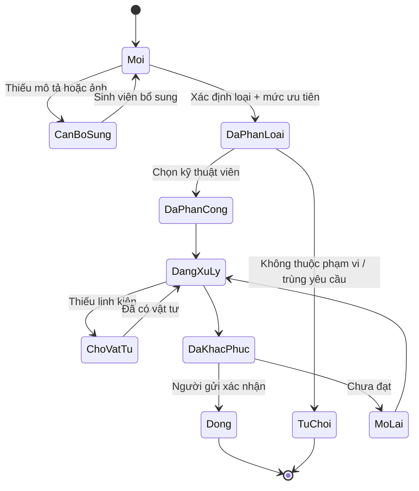

# Ba phương án Dashboard quản lý KTX

> Phạm vi: tài liệu và ảnh xem trước. Chưa triển khai ASP.NET Core, database hay chức năng thật.

## 1. Ý định thiết kế

- **Người sử dụng chính:** nhân viên quản lý KTX trong ca trực tại cơ sở Thủ Đức.
- **Việc quan trọng nhất:** phát hiện và giải quyết các ngoại lệ có nguy cơ ảnh hưởng chỗ ở hoặc trễ SLA — đơn tồn quá 24 giờ, phí quá hạn và sự cố làm khóa phòng.
- **Cảm giác cần đạt:** giống một sổ trực được tổ chức tốt; nhiều dữ liệu nhưng bình tĩnh, có thứ tự và luôn chỉ ra bước tiếp theo.
- **Dữ liệu chung:** 1.142/1.280 chỗ đang sử dụng; còn 138 chỗ; 12 đơn chờ duyệt; 7 hóa đơn quá hạn với 18.450.000 đ; 5 sự cố ưu tiên cao; tỷ lệ thu phí tháng 09 là 86%.

### Khám phá miền thiết kế

- **Khái niệm:** ca trực, bàn giao, tòa–tầng–phòng–giường, giữ chỗ, công suất, công nợ, biên bản, phân công kỹ thuật.
- **Thế giới màu:** giấy sổ trực, sơn tường vôi ấm, biển phòng xanh men, thép xám, đèn cảnh báo hổ phách, dấu khẩn đỏ gạch, cây xanh sân nội trú.
- **Dấu hiệu riêng:** trạng thái phòng/chỗ trống luôn gắn trực tiếp với đơn đăng ký hoặc sự cố đang chiếm chỗ đó.
- **Ba mặc định bị loại:** dãy KPI đồng dạng; sidebar cộng lưới card SaaS; biểu đồ trang trí không dẫn đến thao tác.

## 2. Phân tích cách trình bày

Không có ảnh tham chiếu bên ngoài; ba phương án được suy ra từ nghiệp vụ trong `pasted-text.txt` và nguyên tắc `interface-design`.

- **Bố cục:** mỗi phương án có đúng một vùng thắng về thị giác: hàng đợi, bản đồ phòng hoặc bảng trạng thái.
- **Mật độ:** desktop nghiệp vụ dùng hàng 44–52 px, khoảng cách theo lưới 4/8 px; metadata nhỏ nhưng không thấp hơn ngưỡng đọc thực tế.
- **Phân cấp chữ:** tiêu đề trang 26–30 px; tiêu đề vùng 16–18 px; dữ liệu chính 14–16 px/600–700; metadata 12–13 px; chữ số dùng `tabular-nums` khi triển khai.
- **Màu sắc:** nền ấm và chữ navy/graphite; màu nhấn chỉ dành cho lựa chọn và hành động. Đỏ, hổ phách, xanh lá luôn đi kèm nhãn chữ.
- **Bảng/form:** không mở modal cho quyết định thường xuyên. Hành động nằm ngay tại hàng/thẻ/phòng đang chọn; form xác nhận dùng panel hoặc vùng mở rộng để giữ ngữ cảnh.

## 3. Ba phương án

### A — Hàng đợi ưu tiên

Ảnh: `design-preview/proposals/dashboard-a-hang-doi-uu-tien.png`

- **Tổ chức:** rail điều hướng → thông tin ca trực → hàng đợi trung tâm → công suất và thu phí ở cột phải.
- **Thao tác chính:** lọc theo hạn xử lý, chọn một việc, kiểm tra điều kiện ngay trong hàng và thực hiện `Duyệt hồ sơ`, `Phân công`, hoặc `Gửi nhắc phí`.
- **Điểm mạnh:** nhanh nhất cho công việc lặp lại; độ ưu tiên và SLA rất rõ.
- **Đánh đổi:** quan hệ không gian giữa tòa, tầng và phòng chỉ đóng vai trò ngữ cảnh phụ.

### B — Bản đồ vận hành

Ảnh: `design-preview/proposals/dashboard-b-ban-do-van-hanh.png`

- **Tổ chức:** điều hướng ngang → ma trận bốn tòa chiếm phần lớn màn hình → inspector theo tầng ở bên phải → dải ngoại lệ phía dưới.
- **Thao tác chính:** chọn tòa/tầng/phòng, quan sát chỗ trống và điểm khóa do bảo trì, sau đó xếp phòng hoặc phân công kỹ thuật trong cùng ngữ cảnh.
- **Điểm mạnh:** tốt nhất cho điều phối công suất và phát hiện cụm vấn đề theo vị trí.
- **Đánh đổi:** công việc thu phí và hồ sơ không gắn với phòng cần thêm một bước để xem toàn bộ hàng đợi.

### C — Bảng bàn giao theo trạng thái

Ảnh: `design-preview/proposals/dashboard-c-ban-giao-trang-thai.png`

- **Tổ chức:** sidebar ca trực → nhịp vận hành dạng câu → bốn lane `Cần quyết định`, `Đang xử lý`, `Chờ phản hồi`, `Hoàn tất hôm nay` → thanh bàn giao cố định.
- **Thao tác chính:** mở rộng thẻ tại chỗ, thực hiện bước tiếp theo và chuyển việc sang trạng thái kế tiếp; cuối ca tổng hợp phần chưa hoàn tất.
- **Điểm mạnh:** nhìn rõ nút thắt, người đang giữ việc và chất lượng bàn giao giữa ca.
- **Đánh đổi:** khi số việc tăng mạnh, từng lane cần giới hạn WIP, bộ lọc và cơ chế thu gọn.

### Khuyến nghị

**Phương án A** phù hợp nhất làm Dashboard mặc định vì phản ánh đúng tần suất làm việc của quản lý: vào ca, xử lý ngoại lệ, rồi mới xem số liệu. Có thể đưa ma trận phòng của B vào trang `Phòng ở` và dùng thanh bàn giao của C như một chế độ cuối ca.

## 4. Kiến trúc tổng thể

Identity dùng chung `DormitoryDbContext`; quyền được kiểm tra ở middleware/policy và kiểm tra phạm vi dữ liệu lại trong service. SignalR chỉ phát thông báo sau khi transaction đã commit.

## 5. Pipeline kỹ thuật của request

Đây là **pipeline kỹ thuật**, áp dụng cho mọi use case. Các sơ đồ tiếp theo là **luồng nghiệp vụ** và biểu diễn trạng thái miền.

## 6. Luồng đăng ký phòng

Khi duyệt, service kiểm tra lại số chỗ trong transaction và dùng `RowVersion`/concurrency token. Chỉ sau commit mới cập nhật Dashboard và gửi thông báo.

## 7. Luồng chuyển phòng

## 8. Luồng thu phí

Ràng buộc duy nhất ngăn trùng hóa đơn theo `StudentId + BillingPeriodId`. Giao dịch thanh toán dùng mã tham chiếu/idempotency key duy nhất để retry không ghi nhận hai lần.

## 9. Luồng sửa chữa

Sự cố khẩn có thể khóa phòng hoặc giảm sức chứa khả dụng. Thay đổi này phải được phản ánh vào kiểm tra xếp/chuyển phòng ngay lập tức.

## 10. Trạng thái giao diện cần có khi triển khai

- **Đang tải:** skeleton đúng hình dạng hàng, ô phòng hoặc thẻ trạng thái; không làm nhảy bố cục.
- **Không có dữ liệu:** nêu điều kiện lọc đang dùng và hành động xóa bộ lọc.
- **Lỗi:** thông báo nguyên nhân có thể hành động; giữ dữ liệu form; cung cấp `Thử lại` khi an toàn.
- **Thành công:** cập nhật phần tử tại chỗ, toast ngắn, và chỉ chuyển focus khi thao tác tạo ngữ cảnh mới.

