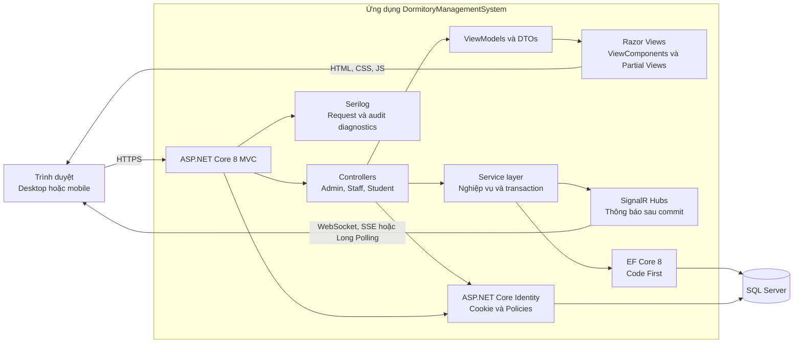
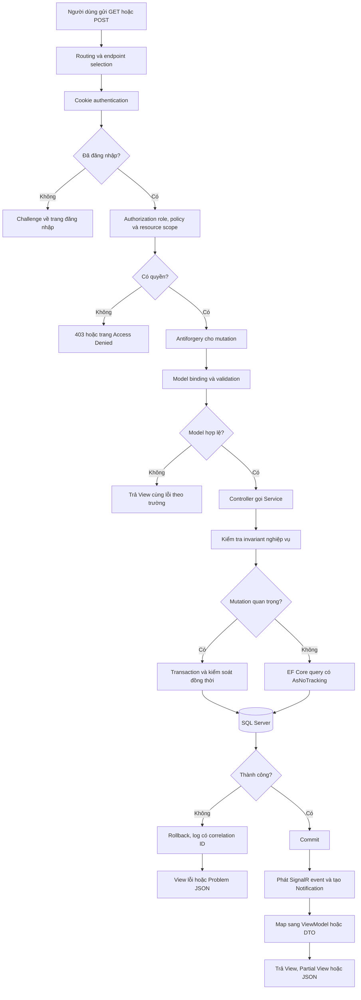
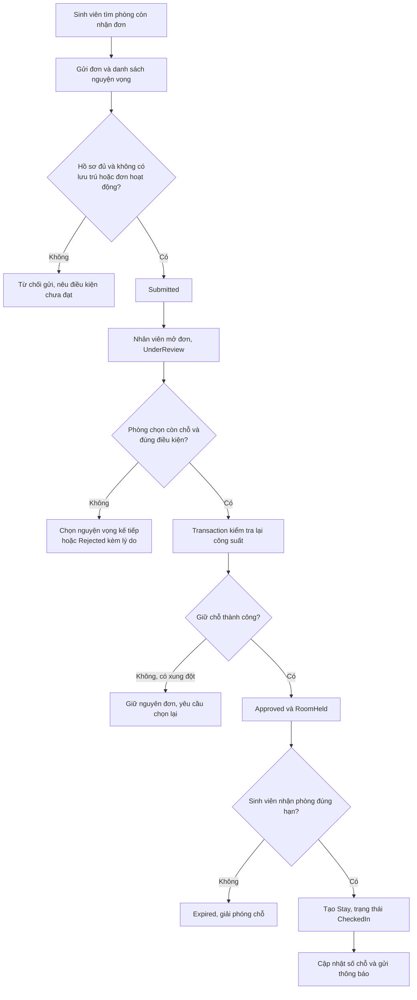
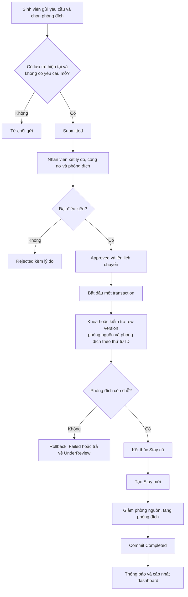
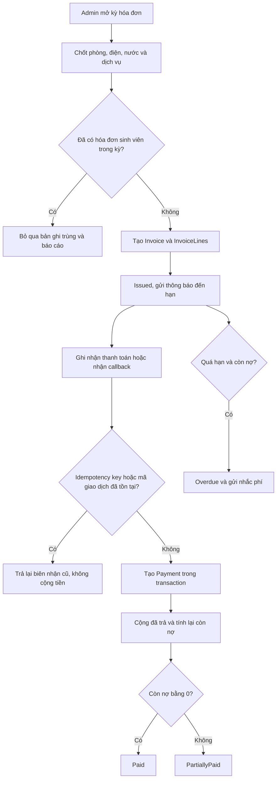
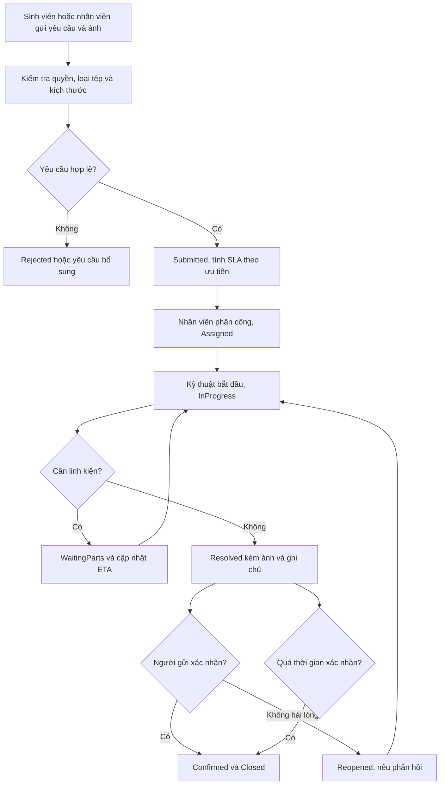
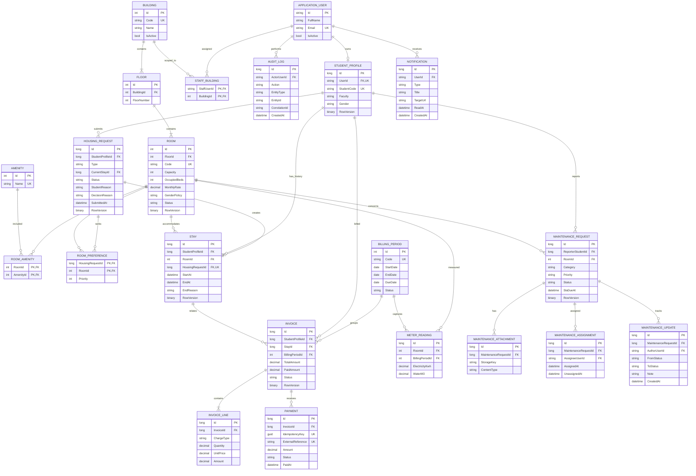

# Dormitory Management System: hồ sơ thiết kế Giai đoạn 1

> Phạm vi tài liệu: khảo sát, thiết kế giao diện, kiến trúc, dữ liệu và kế hoạch. Chưa tạo dự án ASP.NET Core, migration, database hoặc chức năng nghiệp vụ thật.

## 1. Kết quả khảo sát repo tham chiếu

Repo tham chiếu truy cập được và đã được kiểm tra ngày 09/09/2026. Các điểm dùng làm cơ sở:

| Nội dung đã xác minh | Bằng chứng |
|---|---|
| Web SDK, `net8.0`, nullable; Identity EF Core, EF Core Design, SQL Server và Serilog được khai báo bằng package | [`EcommerceApp.csproj`](https://github.com/Anhtuan2005/E-Lectrical--Commerce-/blob/master/EcommerceApp.csproj) |
| `Program.cs` cấu hình văn hóa `vi-VN`, Serilog, SQL Server có retry, Identity và cookie, DI cho các service, Controllers with Views, SignalR, middleware và route hub | [`Program.cs`](https://github.com/Anhtuan2005/E-Lectrical--Commerce-/blob/master/Program.cs) |
| DbContext kế thừa `IdentityDbContext<ApplicationUser>`, dùng Fluent API cho quan hệ, kiểu tiền và unique index | [`Data/AppDbContext.cs`](https://github.com/Anhtuan2005/E-Lectrical--Commerce-/blob/master/Data/AppDbContext.cs), [`Data/Migrations`](https://github.com/Anhtuan2005/E-Lectrical--Commerce-/tree/master/Data/Migrations) |
| Controller mỏng gọi service, admin được bảo vệ bằng role, controller người dùng kiểm tra quyền theo danh tính | [`Controllers/Admin/AdminDashboardController.cs`](https://github.com/Anhtuan2005/E-Lectrical--Commerce-/blob/master/Controllers/Admin/AdminDashboardController.cs), [`Controllers/OrderController.cs`](https://github.com/Anhtuan2005/E-Lectrical--Commerce-/blob/master/Controllers/OrderController.cs) |
| Service có interface, DI, transaction và truy vấn tạo ViewModel cho dashboard | [`Services/IOrderService.cs`](https://github.com/Anhtuan2005/E-Lectrical--Commerce-/blob/master/Services/IOrderService.cs), [`Services/OrderService.cs`](https://github.com/Anhtuan2005/E-Lectrical--Commerce-/blob/master/Services/OrderService.cs) |
| Entity và ViewModel được tách trong `Models`, giao diện chia layout thường và admin | [`Models`](https://github.com/Anhtuan2005/E-Lectrical--Commerce-/tree/master/Models), [`Models/ViewModels`](https://github.com/Anhtuan2005/E-Lectrical--Commerce-/tree/master/Models/ViewModels), [`Views/Shared/_AdminLayout.cshtml`](https://github.com/Anhtuan2005/E-Lectrical--Commerce-/blob/master/Views/Shared/_AdminLayout.cshtml) |
| Razor View dùng dữ liệu ViewModel; CSS và JavaScript quản trị nằm riêng trong `wwwroot`, JavaScript kết nối SignalR và có fallback polling | [`Views/Admin/Dashboard/Index.cshtml`](https://github.com/Anhtuan2005/E-Lectrical--Commerce-/blob/master/Views/Admin/Dashboard/Index.cshtml), [`wwwroot/css/admin.css`](https://github.com/Anhtuan2005/E-Lectrical--Commerce-/blob/master/wwwroot/css/admin.css), [`wwwroot/js/admin.js`](https://github.com/Anhtuan2005/E-Lectrical--Commerce-/blob/master/wwwroot/js/admin.js), [`Hubs/AdminNotificationHub.cs`](https://github.com/Anhtuan2005/E-Lectrical--Commerce-/blob/master/Hubs/AdminNotificationHub.cs) |

Kết luận áp dụng: dự án mới giữ mô hình một ASP.NET Core MVC app với Service layer, Razor Views, CSS và JavaScript thuần; dùng EF Core Code First, Identity cookie, Serilog và SignalR. Domain thương mại điện tử, model, migration và giao diện Techvora không được sao chép sang dự án ký túc xá.

## 2. Hệ thống giao diện đề xuất

Tên hiển thị tạm thời là **Nếp KTX**. Đây là tên giao diện để duyệt, có thể đổi trước khi code.

### Định hướng

Khung cảnh quyết định theme: nhân viên xử lý hàng đợi trên màn hình 24 đến 27 inch trong văn phòng sáng ban ngày; sinh viên tra cứu nhanh trên điện thoại ở hành lang hoặc lớp học. Vì vậy giao diện dùng nền sáng ấm, tương phản cao và không dùng dark mode làm mặc định.

- Phong cách: “Sổ trực vận hành”, gọn, điềm tĩnh, chú trọng hàng đợi và trạng thái.
- Màu: nền giấy ấm, chữ slate, indigo làm màu hành động; xanh lá, hổ phách và đỏ chỉ mang nghĩa trạng thái.
- Font: `Segoe UI`, `Be Vietnam Pro`, `system-ui`; scale cố định, chữ số tiền và công suất dùng trọng lượng cao.
- Khoảng cách: nhịp 4, 8, 12, 16, 24, 32 px; mật độ cao trên desktop và vùng chạm tối thiểu 44 px trên mobile.
- Nút: cao 38 px desktop, 44 px mobile; primary indigo, secondary nền sáng có viền, danger chỉ dành cho từ chối hoặc hủy.
- Bảng: tiêu đề nền trung tính, row hover nhẹ, selection có nền tint; bảng và panel chi tiết nằm cạnh nhau để giảm modal.
- Bộ lọc: hiển thị theo hàng trên desktop; mobile giữ hai bộ lọc thiết yếu và mở rộng phần còn lại theo progressive disclosure.
- Nhãn trạng thái: nền tint nhẹ, luôn có chữ; không dựa vào màu đơn thuần.
- Motion: 150 đến 220 ms, ease-out; chỉ phản hồi hover, focus, toast và thay đổi trạng thái.

### Danh sách ảnh

1. [Dashboard quản lý](../design-preview/screenshots/01-dashboard-quan-ly.png)
2. [Danh sách và chi tiết phòng](../design-preview/screenshots/02-danh-sach-va-chi-tiet-phong.png)
3. [Sinh viên tìm và đăng ký phòng](../design-preview/screenshots/03-sinh-vien-tim-va-dang-ky-phong.png)
4. [Duyệt đăng ký và chuyển phòng](../design-preview/screenshots/04-duyet-dang-ky-va-chuyen-phong.png)
5. [Hóa đơn và theo dõi phí](../design-preview/screenshots/05-hoa-don-va-theo-doi-phi.png)
6. [Yêu cầu sửa chữa và chi tiết tiến độ](../design-preview/screenshots/06-yeu-cau-sua-chua-va-tien-do.png)
7. [Trang tìm phòng trên mobile](../design-preview/screenshots/07-mobile-sinh-vien.png)

Prototype tĩnh nằm tại [`design-preview/index.html`](../design-preview/index.html). Có thể mở trực tiếp và đổi query `screen` giữa `dashboard`, `rooms`, `student`, `applications`, `billing`, `maintenance`. Đây chỉ là bản xem trước giao diện, không gọi API và không ghi dữ liệu.

### Trạng thái hệ thống

| Tình huống | Cách hiển thị | Hành vi |
|---|---|---|
| Đang tải | Skeleton giữ nguyên chiều cao bảng, danh sách hoặc panel; không dùng spinner giữa màn hình | Vô hiệu hóa nút gửi, giữ bộ lọc hiện tại, `aria-busy="true"` |
| Không có dữ liệu | Empty state đặt ngay trong vùng kết quả, nêu lý do và một bước tiếp theo | Có nút “Xóa bộ lọc”, “Tạo kỳ hóa đơn” hoặc “Gửi yêu cầu” tùy ngữ cảnh |
| Lỗi validation | Lỗi cạnh trường, summary đầu form và focus vào lỗi đầu tiên | Giữ nguyên dữ liệu người dùng đã nhập |
| Lỗi mạng hoặc server | Banner trong vùng nội dung, có mã tham chiếu và nút thử lại | Không xóa bảng cũ nếu dữ liệu đang hiển thị vẫn dùng được |
| Xung đột đồng thời | Thông báo “Phòng vừa hết chỗ” hoặc “Hóa đơn đã được ghi nhận ở phiên khác” | Làm mới panel liên quan, không tự gửi lại mutation |
| Thành công | Toast không chặn, đồng thời cập nhật row, badge hoặc timeline | Đưa focus hợp lý về row/panel đã thay đổi; SignalR đồng bộ cho người đang xem |

## 3. Bảng phân quyền

`Admin` có phạm vi toàn hệ thống. `Nhân viên` bị giới hạn theo các tòa nhà được gán. `Sinh viên` bị giới hạn bằng `StudentProfileId` lấy từ người dùng đăng nhập, không nhận ID chủ thể từ form để quyết định quyền.

| Nhóm chức năng | Admin | Nhân viên quản lý KTX | Sinh viên |
|---|---|---|---|
| Tài khoản, vai trò, gán phạm vi tòa | Toàn quyền | Xem hồ sơ bản thân | Xem và đổi thông tin tài khoản bản thân |
| Tòa, tầng, phòng, tiện nghi | Tạo, sửa, ngưng, cấu hình giá | Xem và cập nhật trạng thái trong tòa được gán; không xóa | Chỉ xem phòng đủ điều kiện và còn nhận đăng ký |
| Hồ sơ sinh viên, lịch sử lưu trú | Xem, sửa hành chính, xuất dữ liệu | Xem và cập nhật nghiệp vụ trong phạm vi phụ trách | Xem hồ sơ và lịch sử của chính mình; chỉ sửa trường được phép |
| Đăng ký ở | Xem, duyệt, từ chối, override có audit | Xem, duyệt, từ chối trong phạm vi phụ trách | Tạo, xem và hủy đơn của mình khi chưa xét |
| Chuyển hoặc trả phòng | Xem, duyệt, từ chối | Xử lý trong phạm vi phòng nguồn và đích được gán | Gửi và theo dõi yêu cầu của mình |
| Hóa đơn, biểu phí | Cấu hình, lập kỳ, điều chỉnh, ghi nhận thanh toán | Lập hóa đơn và ghi nhận thanh toán; điều chỉnh cần quyền riêng | Xem hóa đơn, biên nhận và công nợ của mình |
| Sửa chữa | Xem toàn bộ, cấu hình loại, SLA | Tiếp nhận, phân công, cập nhật, đóng trong phạm vi | Tạo yêu cầu, tải ảnh, theo dõi và phản hồi yêu cầu của mình |
| Thông báo | Gửi toàn hệ thống hoặc theo nhóm | Gửi trong phạm vi phụ trách | Nhận, đọc và đánh dấu đã đọc thông báo của mình |
| Dashboard và báo cáo | Toàn hệ thống | Tòa được gán | Chỉ có trang tổng quan cá nhân, không xem số liệu vận hành |

Các policy đề xuất: `CanManageSystem`, `CanManageAssignedBuilding`, `CanApproveHousing`, `CanManageBilling`, `CanAdjustInvoice`, `CanDispatchMaintenance`, `CanAccessStudentSelf`.

## 4. Kiến trúc tổng thể



Identity nằm trong cùng DbContext để liên kết người dùng với `StudentProfile` và phạm vi nhân viên. SignalR không thay thế dữ liệu chuẩn; hub chỉ phát event sau khi transaction đã commit, client nhận event rồi cập nhật badge hoặc tải lại fragment liên quan.

## 5. Pipeline kỹ thuật của một request

Đây là pipeline kỹ thuật dùng chung, khác với các luồng nghiệp vụ ở mục 6.



Quy ước response: điều hướng và trang đầy đủ trả `View`; lọc bảng có thể trả `PartialView`; mutation form dùng Post, Redirect, Get; endpoint hỗ trợ tương tác nhỏ trả JSON có cấu trúc. Controller không thao tác DbContext trực tiếp.

## 6. Luồng nghiệp vụ và trạng thái

### 6.1 Đăng ký phòng

Trạng thái: `Draft → Submitted → UnderReview → Approved → RoomHeld → CheckedIn`. Nhánh kết thúc: `Rejected`, `Cancelled`, `Expired`.



### 6.2 Chuyển phòng

Trạng thái: `Submitted → UnderReview → Approved → Scheduled → Completed`. Nhánh kết thúc: `Rejected`, `Cancelled`, `Failed`.



Không có thời điểm sinh viên có hai lưu trú hiện tại; việc kết thúc lưu trú cũ và tạo lưu trú mới nằm trong cùng transaction.

### 6.3 Thu phí

Trạng thái hóa đơn: `Draft → Issued → PartiallyPaid → Paid`; trạng thái thời gian có thể thành `Overdue`; nhánh quản trị là `Cancelled` hoặc `Adjusted` có audit. Trạng thái thanh toán: `Pending → Succeeded` hoặc `Failed`, `Voided`.



### 6.4 Sửa chữa

Trạng thái: `Submitted → Assigned → InProgress → Resolved → Confirmed → Closed`. Nhánh phụ: `WaitingParts`, `Rejected`, `Reopened`, `Cancelled`.



Thông báo SignalR được phát sau mỗi chuyển trạng thái đã commit. Lịch sử tiến độ là append-only; chỉnh sửa sai phải tạo bản cập nhật hiệu chỉnh, không ghi đè dấu vết cũ.

## 7. ERD đề xuất



### Index và quy tắc dữ liệu bắt buộc

- `Room.Capacity > 0`, `MonthlyRate >= 0`, `OccupiedBeds BETWEEN 0 AND Capacity`.
- Unique `(BuildingId, FloorNumber)` cho tầng và unique `Room.Code` cho phòng.
- Filtered unique index `UX_Stay_CurrentStudent` trên `Stay(StudentProfileId) WHERE EndAt IS NULL` để một sinh viên không có hai lượt ở hiện tại.
- Unique `(StudentProfileId, BillingPeriodId)` trên `Invoice` để không tạo trùng hóa đơn cùng kỳ.
- Unique `(RoomId, BillingPeriodId)` trên `MeterReading`.
- Unique `Payment.IdempotencyKey`; `ExternalReference` có unique filtered index khi khác null.
- `Room.RowVersion`, `HousingRequest.RowVersion`, `Stay.RowVersion`, `Invoice.RowVersion`, `MaintenanceRequest.RowVersion` là SQL Server `rowversion` và EF concurrency token.
- Các trạng thái được giới hạn bằng enum ở C# và check constraint ở database cho dữ liệu quan trọng.
- Không xóa cứng stay, invoice, payment, decision log hoặc maintenance update. Phòng và tài khoản được ngưng hoạt động.

### Chống duyệt đồng thời vượt số chỗ

`HousingService.ApproveAsync` mở transaction `Serializable`, tải lại đơn và phòng, xác minh không có Stay hiện tại, rồi tăng `OccupiedBeds` và tạo `Stay` hoặc `RoomHold`. `Room.RowVersion` làm một trong hai phiên duyệt xung đột. Phiên thua rollback, tải lại trạng thái và trả lỗi nghiệp vụ 409. Filtered unique index trên Stay là lớp bảo vệ cuối cho lưu trú trùng.

Với chuyển phòng, service khóa hoặc cập nhật hai phòng theo thứ tự `RoomId` tăng dần để giảm deadlock; kết thúc Stay cũ, tạo Stay mới, giảm phòng nguồn và tăng phòng đích trong một transaction. Không phát SignalR trước commit.

### Chống ghi nhận thanh toán trùng

Client tạo `IdempotencyKey` cho mỗi lần gửi. Service insert `Payment` với unique key trước khi cộng tiền. Request lặp lại nhận biên nhận đã tồn tại. Callback cổng thanh toán còn dùng unique `ExternalReference`. Payment và cập nhật `Invoice.PaidAmount/Status` nằm trong cùng transaction; số dư luôn được đối chiếu từ tổng payment `Succeeded`.

## 8. Cấu trúc mã nguồn đề xuất

```text
DormitoryManagementSystem.sln
src/
  DormitoryManagementSystem/
    DormitoryManagementSystem.csproj
    Program.cs
    appsettings.json
    Authorization/
      Policies.cs
      BuildingScopeHandler.cs
    Controllers/
      AccountController.cs
      Admin/
      Staff/
      Student/
    Data/
      AppDbContext.cs
      Configurations/
      Migrations/
      Seed/
    Hubs/
      NotificationHub.cs
    Models/
      ApplicationUser.cs
      Buildings/
      Housing/
      Billing/
      Maintenance/
      Notifications/
    Services/
      Contracts/
      Rooms/
      Housing/
      Billing/
      Maintenance/
      Notifications/
      Dashboard/
    ViewModels/
      Admin/
      Staff/
      Student/
      Shared/
    Views/
      Account/
      Admin/
      Staff/
      Student/
      Shared/
    wwwroot/
      css/
      js/
      images/
      uploads/
tests/
  DormitoryManagementSystem.Tests/
  DormitoryManagementSystem.IntegrationTests/
design-preview/
docs/
```

Trách nhiệm:

- Controller: nhận request, áp authorization, map input, gọi đúng service, trả View, Partial View hoặc JSON; không chứa query nghiệp vụ.
- Service: điều kiện nghiệp vụ, transition trạng thái, transaction, concurrency, idempotency và tạo notification.
- Model: entity bền vững và invariant cốt lõi; không dùng entity làm model form.
- ViewModel: đúng dữ liệu một màn hình hoặc form, có validation attribute, format và quyền hành động đã tính sẵn.
- View: trình bày và progressive enhancement; không quyết định quyền truy cập hay tính tiền.
- JavaScript: lọc, partial refresh, toast, upload preview và SignalR; mọi thao tác vẫn có đường POST phía server.

## 9. Kế hoạch triển khai Giai đoạn 2

| Bước | Phụ thuộc | Đầu ra | Tiêu chí hoàn thành |
|---|---|---|---|
| 1. Scaffold và nền tảng | Thiết kế được duyệt | Solution, MVC project, test projects, Serilog, cấu hình môi trường | `dotnet build` thành công; secret không nằm trong repo |
| 2. Identity và authorization | Bước 1 | User, 3 role, policies, seed tài khoản demo | Test truy cập role và resource scope qua 200, 302, 403 đúng kỳ vọng |
| 3. Domain và database | Bước 2 | Entity, Fluent configurations, initial migration, seed tòa và phòng | Migration tạo được SQL Server mới; constraint và unique index tồn tại |
| 4. App shell và design system | Bước 1 | Layout Razor, partials, CSS tokens, responsive navigation, state patterns | So khớp mockup ở desktop và mobile; bàn phím dùng được |
| 5. Phòng và sinh viên | Bước 3, 4 | CRUD tòa, tầng, phòng, tiện nghi; hồ sơ và lịch sử | Tìm, lọc, phân trang; dữ liệu theo scope; không xóa lịch sử |
| 6. Đăng ký ở | Bước 5 | Tìm phòng, gửi đơn, xét duyệt, giữ chỗ, nhận phòng | Test hai lượt duyệt chỗ cuối chỉ một lượt thành công |
| 7. Chuyển và trả phòng | Bước 6 | Request, quyết định và transaction đổi Stay | Test lỗi giữa transaction không làm lệch hai phòng; không có hai Stay hiện tại |
| 8. Hóa đơn và thanh toán | Bước 5 | Kỳ phí, chỉ số, invoice lines, payment, công nợ | Không tạo trùng kỳ; request payment lặp không cộng tiền lần hai |
| 9. Sửa chữa và ảnh | Bước 5 | Upload an toàn, phân công, timeline, SLA, phản hồi | Kiểm tra loại và dung lượng file; mọi transition có audit |
| 10. Thông báo và SignalR | Bước 6 đến 9 | Notification store, hub, badge và fallback tải lại | Event chỉ phát sau commit; disconnect không làm mất dữ liệu chuẩn |
| 11. Dashboard và báo cáo | Bước 6 đến 10 | Số liệu lấp đầy, công nợ, hàng đợi và sự cố | Số liệu đối chiếu đúng với truy vấn nguồn; lọc theo scope |
| 12. Hardening và bàn giao | Tất cả | Integration tests, security review, README, ảnh chạy thật | Build sạch; test quan trọng đạt; hướng dẫn setup từ database trống chạy được |

## 10. Giả định nghiệp vụ cần duyệt

1. Một sinh viên chỉ có một `Stay` hiện tại và một housing request đang hoạt động tại một thời điểm.
2. Phòng có chính sách giới tính; sinh viên chỉ thấy phòng mình đủ điều kiện.
3. “Duyệt và giữ chỗ” giữ chỗ trong 72 giờ. Hết hạn chưa nhận phòng thì tự giải phóng.
4. Giá phòng được chụp vào invoice line theo từng kỳ; đổi giá sau đó không sửa hóa đơn đã phát hành.
5. Điện, nước được nhập theo phòng rồi phân bổ đều cho số sinh viên ở theo ngày lưu trú trong kỳ. Có thể đổi sang đồng hồ cá nhân nếu nghiệp vụ thực tế yêu cầu.
6. Nhân viên chỉ thao tác các tòa được gán. Yêu cầu chuyển giữa hai tòa cần người có quyền ở cả hai tòa hoặc Admin.
7. Thanh toán Giai đoạn 2 trước mắt hỗ trợ ghi nhận tiền mặt hoặc chuyển khoản; tích hợp cổng thanh toán là extension riêng nếu được yêu cầu.
8. Ảnh sự cố lưu ngoài database; DB chỉ giữ metadata và storage key. Giới hạn đề xuất 5 ảnh, 5 MB mỗi ảnh, JPG, PNG hoặc WebP.
9. Hóa đơn quá hạn khi qua `DueDate` và còn nợ lớn hơn 0; nhắc phí chạy bằng hosted service mỗi ngày và không gửi trùng cùng loại trong ngày.
10. Admin có thể override quyết định nhưng bắt buộc nhập lý do; mọi override được ghi AuditLog.
