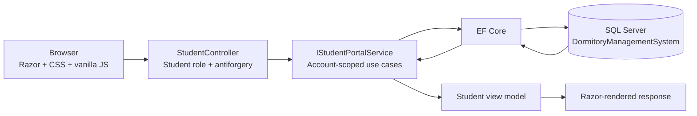
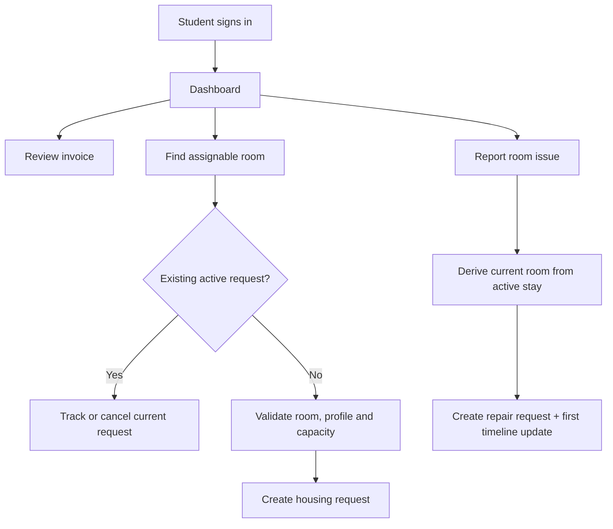

# Implementation checkpoint — Student portal

## Delivered scope

The Student role now enters a dedicated student portal instead of the default MVC welcome page. The portal is intentionally organised around the student's immediate work: the next unpaid invoice, current room, request progress and repair status.

- Dashboard with room pass, unpaid invoice, current request/repair and notifications.
- Assignable-room search with building, price, amenity and sort filters.
- Housing-request history, submit and cancel flows.
- Database-backed invoice list and charge-line detail.
- Repair history, status timeline and submit flow tied to the current stay.
- Responsive desktop/mobile navigation and UI-only grounded chatbot demonstration.

Online payment and external AI/model integration are not part of this checkpoint.

## Request pipeline

The browser never sends a student ID. `StudentPortalService` resolves the `StudentProfile` from the authenticated Identity user and derives the current room from the active stay.

## Student task flow

## AI assistant boundary

The current assistant is a frontend demonstration. It handles a small approved-demo question set, shows the demo source name and links to the appropriate portal page. Unknown questions return a contact-management fallback. It does not call an external model, inspect personal records through chat or contain an API key.

Documents required before model integration:

- Confirmed dormitory regulations and version/effective date.
- Registration, transfer and check-out procedures.
- Official fee schedule, payment channels and deadlines.
- Repair intake and emergency escalation procedure.
- Student-service contact directory and operating hours.
- Approved URLs for each cited source.

## Verification

- Release build: zero warnings and zero errors.
- Browser checks: dashboard redirect, desktop/mobile rendering, room-selection dialog, repair deep link, chatbot source/route and Student-role denial on `/Rooms/Map`.
- Mutating browser smoke: housing request submit/cancel and repair submit. Test rows are deleted after the run.
- SQL seed: `SV002106` is linked to `student@nepktx.local`, room `A-302`, two invoices, one historical request, one active repair and two notifications.
